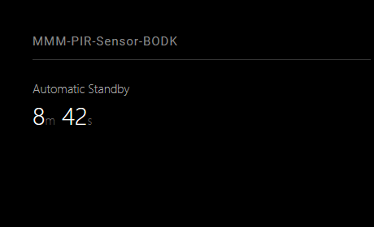

# MMM-PIR-Sensor-BODK

## Description

MagicMirror² module for switching a monitor off after inactivity and waking it when a PIR sensor detects presence. Local continuation of [MMM-PIR-Sensor-Lite by Grena](https://github.com/grenagit/MMM-PIR-Sensor-Lite), licensed under MIT. The original copyright is retained in LICENSE.

### Preview

Default countdown display with a fictional standby deadline. This browser preview does not test GPIO or screen power control. English is the default language.



The [browser preview](docs/preview.html) uses fictional data only; it does not validate external services or hardware.

## Requirements

A working MagicMirror² installation and a Node.js version supported by that installation.

A supported Raspberry Pi GPIO environment, a PIR sensor and a display backend accessible from the MagicMirror² desktop session are required. Choose `xrandr`, `xset`, `vcgencmd` or `wlr` according to your system.

Python 3 with venv and pip support must be installed first. On Raspberry Pi OS:

```sh
sudo apt install python3-venv python3-pip
```

`npm install` creates a module-local `.venv` and installs `requirements.txt`. Set `PYTHON` to another Python executable during installation if needed. npm does not install operating-system packages.

On supported Raspberry Pi architectures, setup installs `RPi.GPIO` or uses an available system package. Raspberry Pi 5 requires separate compatibility verification.

## Installation

Run these commands on the device running MagicMirror²:

```sh
cd ~/MagicMirror/modules
git clone https://github.com/BravoOscarDK/MMM-PIR-Sensor-BODK.git
cd MMM-PIR-Sensor-BODK
npm install
```

Keep the folder name `MMM-PIR-Sensor-BODK` unchanged. Complete the configuration below, then restart MagicMirror² using your usual startup method.

Disable the original MMM-PIR-Sensor-Lite module before enabling this module, so only one helper controls the sensor and monitor.

## Configuration

Add this entry to the `modules` array in `config/config.js`, retaining your existing pin, output and command settings:

```js
{
  module: "MMM-PIR-Sensor-BODK",
  position: "top_right",
  config: {
    language: "en",
    sensorPin: 2,
    commandType: "xrandr",
    hdmiPort: "HDMI-1",
    deactivateDelay: 15 * 60 * 1000,
    verifyPower: true,
    wakeOnMouse: true
  }
}
```

Pins use BCM numbering, not physical header positions. Only one sensor/display configuration per module helper is supported.

| Option | Default | Description |
| --- | --- | --- |
| `language` | `"en"` | Display language: English (`en`) or Danish (`da`). |
| `sensorPin` | `0` | Required BCM pin, integer 1-27. Zero indicates missing configuration. |
| `commandType` | `"xrandr"` | `"xrandr"`, `"xset"`, `"vcgencmd"` or `"wlr"`. Retain the command working on your Pi. |
| `hdmiPort` | `"HDMI-1"` | Exact output name for xrandr or wlr (e.g. `HDMI-A-1`); use `xrandr --query` or `wlr-randr` to list outputs. |
| `rotation` | `"normal"` | xrandr/wlr rotation: normal, left, right or inverted (wlr transforms: normal, 90, 270, 180). |
| `deactivateDelay` | `900000` | Inactivity period in milliseconds, integer 1000-86400000. |
| `verifyPower` | `true` | Query display output state after each command; retry on failure or mismatch. |
| `wakeOnMouse` | `true` | Mouse movement in the MagicMirror² window wakes the display and resets the inactivity timer, including input delivered through VNC. Set to `false` to disable. |
| `debugMode` | `false` | Simulate display changes without running display commands. Sensor still runs. |
| `title` | `null` (translated automatic title) | Countdown title; empty string hides it. |
| `showCountDown` | `true` | Display countdown; disabling it stops periodic UI updates. |
| `showDetection` | `true` | Show detection icon independently of the countdown. |
| `updateInterval` | `1000` | UI refresh milliseconds; clamped to 100-5000; zero uses 1000. |
| `animationSpeed` | `1000` | Detection icon duration; at least 100 ms (zero uses 1000 ms). UI updates use no animation to prevent countdown flicker. |
| `hoursLabel` | `"h"` | Hours label. |
| `minutesLabel` | `"m"` | Minutes label. |
| `secondsLabel` | `"s"` | Seconds label. |

### Wayland example

```js
{
  module: "MMM-PIR-Sensor-BODK",
  position: "top_left",
  config: {
    language: "en",
    title: "Automatic standby",
    sensorPin: 23,
    commandType: "wlr",
    hdmiPort: "HDMI-A-1",
    rotation: "left",
    deactivateDelay: 10 * 60 * 1000
  }
}
```

`wlr-randr` must be installed and runnable in the same desktop session as MagicMirror². The module uses `--output <name> --off` to disable the output and `--output <name> --on --transform <rotation>` to enable it. Verification reads the selected output's `Enabled` field; other outputs are ignored.

## Language

English is the default, independently of the MagicMirror² global language. Set the language in this module's `config`:

```js
language: "en" // English (default); use "da" for Danish.
```

Unsupported languages fall back to English. Custom labels, device names and upstream data retain their configured or reported values. Technical logs and diagnostic errors are in English.

## Updating

For an installation created with `git clone`:

```sh
cd ~/MagicMirror/modules/MMM-PIR-Sensor-BODK
git pull --ff-only
npm install
```

Restart MagicMirror² using your usual startup method. Keep your module settings in `~/MagicMirror/config/config.js`. If Git reports local changes or diverging branches, preserve those changes and resolve the issue before updating. A ZIP download or copied folder must be replaced manually or migrated to a Git clone before using `git pull`.

## Troubleshooting

Mouse activity is sent at most once every 500 ms and uses the same display control as PIR activity. It remains active when the module is hidden. VNC must control the desktop session running MagicMirror², and pointer events must reach the MagicMirror² window. Movement over other applications or in a separate virtual VNC desktop is not detected. Some VNC/compositor setups stop delivering pointer events when an output is disabled; this feature cannot wake the display in that case. A remote browser opened directly on MagicMirror² can also wake the Pi's display by moving the mouse over the page. During a sensor outage, mouse activity keeps the display on without restarting the standby timer.

Mouse events are ignored during display commands and verification, and for one second after completion. The first pointer event establishes a position baseline; events at the same position and scripted events are ignored. This prevents pointer repositioning during output changes from immediately waking the display and restarting the countdown. PIR detection remains active throughout display changes. A wake from standby logs `Wake requested by mouse` or `Wake requested by PIR` in the server log; sensor restarts are logged separately.

The sensor stabilizes for two seconds before announcing readiness. GPIO is polled every 100 ms and presence is reported approximately every 500 ms while the input is high. The inactivity timer starts after sensor readiness and resets with each presence message. A sensor that remains high will keep the screen on, even if a person has already left; the PIR's own hold time is part of this behaviour.

Display commands run sequentially. Movement during a pending switch-off queues a switch-on. Each command has a 10-second timeout; failures are logged and retried after five seconds without requiring new movement. The query runs after a 300 ms settling period and uses `xrandr --query`, `xset q` , `vcgencmd display_power` or `wlr-randr`. This checks the software-reported output state, not the physical panel or its power consumption. There is no continuous monitoring of changes made by other programs.

If a query is unsupported on an otherwise working setup, the module displays a verification error. Set `verifyPower: false` to retain command exit-code checks and retries without the extra query. Capture the error before disabling verification so it can be investigated.

An exited sensor is restarted after five seconds. A sensor process that has not reported readiness within 15 seconds is terminated for restart. During a sensor outage the inactivity timer is cancelled and the screen is kept on, so a failed sensor does not leave it asleep. Sensor and display errors appear in the module and server log. Shutdown clears backend timers and terminates child processes; hiding the module stops its UI timers while presence detection continues.

This release retains RPi.GPIO and supports Wayland output control through `commandType: "wlr"` using `wlr-randr`. The compositor must implement the wlr output-management protocol, and MagicMirror² must run with access to the active Wayland session. It does not add a new Raspberry Pi 5 GPIO backend. Hardware compatibility must be tested on the target Pi. Core project: [MagicMirror²](https://github.com/MagicMirrorOrg/MagicMirror).

## Validation

```sh
npm test
npm run check
```

Automated tests do not establish hardware compatibility. Verify the module on your own MagicMirror² installation.

### Hardware verification

1. Back up your current module and config. Copy BODK and enable only the BODK config entry.
2. Temporarily use `deactivateDelay: 30000`, retaining your working sensorPin, commandType and hdmiPort.
3. Wait for the countdown, then leave the sensor area. Check that the screen switches off after the PIR signal has gone low and the delay expires.
4. Move in front of the sensor and confirm that the screen wakes and the countdown restarts. Repeat at least ten times, including movement near the moment of switch-off.
5. If it fails, save the MagicMirror² server log lines containing `MMM-PIR-Sensor-BODK`, especially `Monitor off failed`, and note whether the countdown reached zero.
6. Connect through VNC to the same desktop session, wait for standby, then move the mouse over the MagicMirror² window. Confirm that the display wakes and the countdown restarts. Keep moving the mouse and confirm that standby is postponed. With `wakeOnMouse: false`, mouse movement should no longer reset the module's countdown (the desktop itself may still wake some display backends).
7. Restore your normal delay when finished.

Standalone sensor check (stop MagicMirror² first to avoid simultaneous GPIO access):

```sh
~/MagicMirror/modules/MMM-PIR-Sensor-BODK/.venv/bin/python -u ~/MagicMirror/modules/MMM-PIR-Sensor-BODK/pir.py 2
```

Replace `2` with your BCM pin. Expect `PIR_START` after stabilization and `USER_PRESENCE` while the signal is high. Ctrl+C releases the selected pin.

## License

MIT. See [LICENSE](LICENSE) for license terms and attribution.
